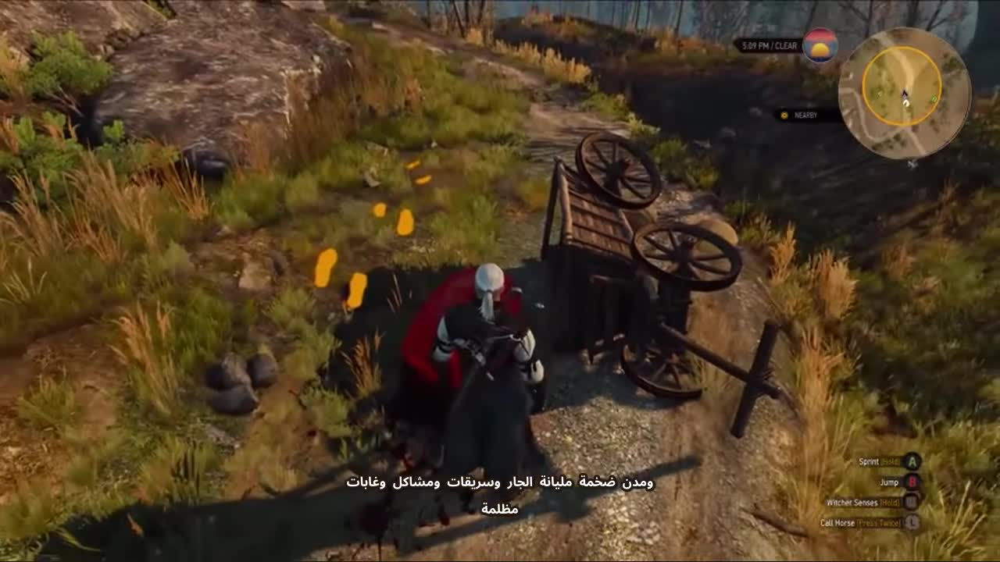

# معاينات التسجيل الحقيقي — 15 أكتوبر 2026

هذه معاينات جزئية لفحص جلب اللقطات والتصدير؛ ليست الحلقة الطويلة أو شورتات جاهزة للنشر. رفعها المالك للمعاينة صراحةً. الملفات السابقة محفوظة كما هي.

- [معاينة أفقية 42 ثانية](https://raw.githubusercontent.com/ClearDataIQ/Rashspeak/main/previews_2026_10_15/RashSpeak_Gameplay_Review_16x9.mp4)
- [معاينة عمودية 42 ثانية](https://raw.githubusercontent.com/ClearDataIQ/Rashspeak/main/previews_2026_10_15/RashSpeak_Gameplay_Review_9x16.mp4)
- [معاينة صوت المؤثرات 65 ثانية](https://raw.githubusercontent.com/ClearDataIQ/Rashspeak/main/previews_2026_10_15/RashSpeak_Real_SFX_Review.mp3) — المؤثران عند 0:17 و0:55 تقريبًا.

الفيديوهان من 117.15 إلى 159.59 ثانية من تسجيل المالك، بنفس ترتيب الكلام. تظهر لقطات The Witcher 3 حقيقية، بلا بطاقات في هذا المدى. لا مؤثرات أو ميمز داخل هذا المدى؛ ملف اختبار المؤثرات منفصل. النسخة العمودية تستخدم تأطير cover في المحرر. الترجمة تفريغ آلي يحتاج مراجعة، وبعض المصدر 480p. لا توليد صور أو فيديو بالذكاء الاصطناعي.

التغطية السابقة للحلقة الكاملة بعد إصلاح مدة المقتطفات 12.856% فقط؛ لهذا لم يُنتج فيديو طويل نهائي. جلب YouTube محجوب من شبكة السحابة قبل المصادقة، والمصدر البديل لم يجد لقطات كافية لباقي الألعاب، ثم بلغ Gemini حد الاستخدام. لم يتوفر أصل ميم مناسب موثق. يجري إصلاح الاستكمال وكفاءة الاختيار وتوسيع المصادر.

حقوق المقاطع ونسبها في [SOURCE_CREDITS.txt](SOURCE_CREDITS.txt)، والأحجام والبصمات في [FILES_SHA256.json](FILES_SHA256.json). لا تحتوي هذه الملفات مفاتيح أو بيانات حسابات أو التسجيل الأصلي الكامل.
