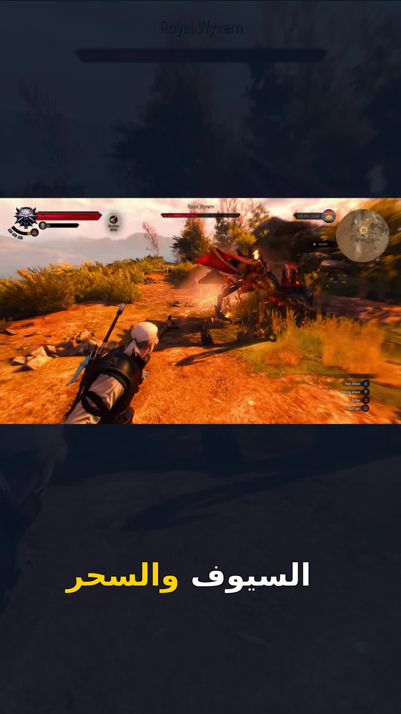

# شورت جديد بعد إصلاحات الترجمة والجودة

[مشاهدة وتنزيل الشورت — MP4](RashSpeak_New_Short_1080x1920.mp4) · [رابط مباشر](https://raw.githubusercontent.com/ClearDataIQ/Rashspeak/main/short_after_fixes_2026_10_15/RashSpeak_New_Short_1080x1920.mp4)

12 ثانية، 1080×1920، 30fps، بصوت المالك من مقطع متصل. اللقطات من مصدر ألعاب أصلي بدقة 1920×1080، ونسب الحقوق في SOURCE_CREDITS.txt. لا موسيقى مضافة ولا صور أو فيديوهات مولدة بالذكاء الاصطناعي.

تظهر حوارات عند الحديث عن القصة، ثم قتال بالسيف وهجوم ناري عند ذكر السيوف والسحر. أُعيد التأطير لإظهار الشخصيات وإزالة شريط الترجمة الإنجليزية في مشاهد الحوار. الخلفية الخافتة نسخة من اللقطة الأصلية نفسها. الترجمة أكبر وحافتها أرفع مع تمييز الكلمات، ويوجد مؤثر ختامي خافت بعد انتهاء الكلام.

**طريقة الإنتاج:** اختيار اللقطات وتوقيتها راجعهما المطور يدويًا لهذه المعاينة، وصُححت كتابة «الحالها» إلى «لحالها» عبر أمر تحرير الكلمات القابل للتراجع. بقية الكلمات من التفريغ المحلي medium وتحتاج سماع المالك؛ لم يُرفق سكربت مستقل. الرندر الفعلي من محرك Pro Editor المشترك في الأداة، والمشروع المحلي متعدد المسارات حُفظ وأعيد فتحه.

هذه معاينة بطلب المالك بعد الإصلاحات. لا تُعد إثباتًا لنجاح اختيار اللقطات تلقائيًا عبر Gemini؛ المفتاح غير متاح للتطبيق في البيئة الحالية. الفيديو الطويل واختبار المونتاج التلقائي الكامل ما زالا غير معتمدين. الملفات السابقة محفوظة كما هي.

تثبت VERIFICATION.json الأبعاد والمدة وعدد الإطارات وفحص فك الترميز وبصمات الملفات. لا يتضمن المجلد التسجيل الكامل أو مفاتيح أو بيانات حسابات.
